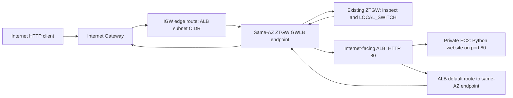

# AWS ingress lab through an existing Zscaler ZTGW

This lab implements internet ingress through an existing Zscaler ZTGW.
It creates the AWS consumer VPC and endpoints for an **existing** ZTGW service,
an HTTP Application Load Balancer, a private EC2 website, and the associated ZTC
traffic-forwarding rules. Direct Connect, on-premises/DC flows, and the database
VPC are outside this lab.

One root Terraform configuration manages AWS resources and Zscaler forwarding
rules in the same state. Run `terraform apply` from this directory to manage
both, including activation by default. Zscaler credentials are required during
planning and applying, including when AWS resources already exist.
No ZTGW instances, GWLB, endpoint service, or Zscaler location are created.

## Architecture and routing



The ALB is internet-facing because an internal ALB cannot directly receive
internet traffic. The EC2 backends remain private. The ALB has dedicated inspected
subnets; the internet gateway diverts traffic to their **private subnet CIDRs**
through the matching AZ's endpoint before delivery to the ALB. AWS IGW address
translation occurs before the private destination is routed through the endpoint.

The diagram's `0.0.0.0/0 -> GWLBe` ingress-table label is conceptual. AWS gateway
route tables only accept destinations inside the VPC. This implementation uses a
more-specific route for each ALB subnet and retains the VPC local route. Return
traffic uses the same AZ's endpoint to preserve inspection symmetry.

| Route table | Destination | Target |
| --- | --- | --- |
| IGW edge-associated table | Each ALB subnet CIDR | That AZ's ZTGW endpoint |
| ALB subnet table, per AZ | `0.0.0.0/0` | Same-AZ ZTGW endpoint |
| Inspection subnet table, per AZ | `0.0.0.0/0` | IGW |
| All tables | VPC CIDR | Local (AWS automatic route) |
| Private web table | VPC CIDR only | Local; no internet default route |

ALB-to-backend traffic and health checks are local, after client traffic has
passed inspection. No NAT gateway or public EC2 IP is used. This is transparent
Layer 4 forwarding; it does not configure TLS termination, WAF rules, ZIA
inspection, or application authentication.

For the default `10.10.11.0/24` VPC, Terraform derives these non-overlapping subnets:

| AZ slot | ALB | GWLB endpoint | Private web |
| --- | --- | --- | --- |
| `az1` | `10.10.11.0/27` | `10.10.11.64/28` | `10.10.11.128/27` |
| `az2` | `10.10.11.32/27` | `10.10.11.80/28` | `10.10.11.160/27` |

## Prerequisites and variables

- Terraform **1.5+** for deployment; **1.7+** for the mocked tests.
- AWS credentials via the normal AWS profile/environment/role chain. Deployment
  needs EC2/VPC, ELB, endpoint-service discovery, and (when SSM is enabled) IAM
  role/profile and `iam:PassRole` permissions.
- An existing ZTGW GWLB service in the selected region, healthy appliances, and
  endpoint-service authorization for your AWS account. Complete any acceptance
  required by the service owner. The service must support two standard AZs that
  are available to this AWS account.
- The existing gateway's ZTC location name and Zidentity OneAPI credentials with
  traffic-forwarding policy and activation permissions.

Providers are pinned to the tested `hashicorp/aws = 5.100.0` and
`zscaler/ztc = 0.1.9` (pre-1.0). Keep the root `.terraform.lock.hcl` committed. The ZTC
configuration assumes your established **OneAPI/Zidentity** authentication mode;
legacy authentication would require a provider configuration change.

For a new setup, copy the example and replace its placeholders. If you already
have `terraform.tfvars`, keep it and add any desired policy overrides:

```bash
cd /path/to/aws-ztgw-ingress
cp terraform.tfvars.example terraform.tfvars
```

| Root input | Purpose / default |
| --- | --- |
| `aws_region` | Region containing the existing service; `us-west-1` |
| `ztgw_endpoint_service_name` | Required real regional GWLB service name |
| `ztgw_location_name` | Required existing ZTC location name for the integrated policy |
| `name_prefix` | Unique lab name, 1–20 characters; `ztgw-ingress` |
| `vpc_cidr` | Canonical IPv4 network `/16` through `/24`; `10.10.11.0/24` |
| `availability_zones` | Empty auto-selects two available service-supported AZs; otherwise specify two |
| `allowed_client_cidrs` | HTTP client source CIDRs; default `0.0.0.0/0` |
| `web_instance_count` | `1` by default; `2` creates a backend in each AZ |
| `instance_type` | Available x86_64 instance type; `t3.micro` |
| `enable_ssm` | Private SSM management with IAM and interface endpoints; `true` |
| `rule_order` / `rule_rank` | HTTP allow position/rank; `1` / `7`; DROP follows immediately |
| `enable_policy_activation` | Activate pending ZTC changes in the same apply; `true` |
| `activation_revision` | Increment to request another activation without changing rules; `"1"` |

For a restricted lab, set `allowed_client_cidrs` to your actual public client IP
as a `/32`. That allowlist is used by both the ALB security group and the ZTC HTTP
rule. For ZTC only, an allowlist containing `0.0.0.0/0` becomes an empty
source filter (any source); the DROP rule also omits the source filter. Sending
an explicit `/0` source range can cause the API to reject `255.255.255.255`.
AWS security groups retain the original CIDRs.
Terraform does not automatically read `.example` files. Keep real values
in ignored `terraform.tfvars`, not the committed example.

## 1. Configure Zscaler credentials and policy

Use Zidentity OneAPI credentials in the shell running the root apply:

```bash
export ZSCALER_CLIENT_ID="YOUR_ZIDENTITY_API_CLIENT_ID"
export ZSCALER_CLIENT_SECRET="YOUR_ZIDENTITY_API_CLIENT_SECRET"
export ZSCALER_VANITY_DOMAIN="YOUR_ZIDENTITY_PREFIX"
# ZSCALER_PRIVATE_KEY may be used instead of the client secret.
# ZSCALER_CLOUD is optional and only needed for non-production, e.g. beta.
```

Alternatively, your existing `TF_VAR_ztc_client_id`, `TF_VAR_ztc_client_secret`
(or `TF_VAR_ztc_private_key`), and `TF_VAR_ztc_vanity_domain` exports are supported.
Pick one consistent credential source. Do not commit secrets or put a full
Zidentity URL in the vanity-domain field.

Optional policy settings in the root `terraform.tfvars`:

```hcl
rule_order = 1
rule_rank  = 7
enable_policy_activation = true
```

`rule_order` is the allow rule's position; DROP follows at the next position.
Review existing tenant rules so earlier rules do not shadow this lab's rules.
Rule ordering is tenant-wide and can renumber other rules: coordinate changes
with any other Terraform state managing that tenant. Do not apply multiple
Zscaler states concurrently.

The root apply creates:

1. `LOCAL_SWITCH`, service **HTTP**, configured client source CIDRs, destination
   ALB subnet CIDRs, scoped to the existing location.
2. `DROP`, any service/source, scoped to the same ALB destinations and location.

This forwards accepted inbound traffic back into the consumer VPC after ZTGW
inspection, without sending ingress traffic to ZIA. No ZPA application rule,
workload group, or broad tenant-wide allow is created. Return traffic relies on
the existing ZTGW's stateful handling of the accepted connection.

## 2. Deploy AWS and Zscaler together

```bash
terraform init
terraform fmt -check -recursive
terraform validate
terraform plan -out=tfplan
terraform apply tfplan
terraform output website_url
terraform output rule_ids
terraform output activation_requested
```

If you previously applied only the AWS root, keep the existing state and
`terraform.tfvars`. Run `terraform init` to install the added ZTC provider, then
create a fresh plan. The plan should retain existing AWS resources and add the
Zscaler rules and activation. Review any unexpected AWS changes before applying.
The root derives policy destinations directly from its ALB subnet configuration;
there is no exported JSON file or separate policy apply.

A pending endpoint may require acceptance by the Zscaler service owner before
AWS provisioning completes. Review the plan for both providers before applying.
An apply can partially succeed: if one provider fails, fix the error and plan/apply
again using the same state.

**Activation is required and enabled by default.** Activation waits for both
managed forwarding rules. It publishes **all pending tenant changes**, including
unrelated edits; review pending changes before applying. Set
`enable_policy_activation = false` if you want rules created as drafts, then
activate manually in the portal. If you need another activation with unchanged
rules, increment `activation_revision`. The trigger tracks configured fields and
stable IDs, avoiding provider-readback normalization errors. Destroying the
activation resource does not publish rule deletions; see cleanup below.

The root uses Terraform 1.5+ with ZTC 0.1.9 and OneAPI authentication. Both AWS
and tenant policy now share one state and apply lifecycle. Serialize applies
against this tenant, including runs from other projects.

## 3. Validate the live path

```bash
terraform output -raw website_url
curl -v "$(terraform output -raw website_url)/"
```

The response should contain **ZTGW ingress lab**. The ALB forwards HTTP on port 80
to the private instance. Standard Amazon Linux 2023 includes Python 3; user data
starts a systemd HTTP server with no package downloads. Inspect the ALB target
group health if the ALB returns 503.

A successful page alone does not prove Zscaler policy enforcement. Correlate the
request's source/destination with the existing ZTGW's traffic logs, verify the
`LOCAL_SWITCH` rule hit, and test an excluded client after restricting the client
CIDRs. Review AWS route-table outputs to confirm both ingress and return use the
expected same-AZ endpoint. HTTP/80 is the only public listener in this lab.

When SSM is enabled, use EC2 Session Manager to inspect a private backend:

```bash
systemctl status ztgw-web.service
curl -I http://localhost/
cat /var/log/cloud-init-output.log
```

Private management uses `ssm` and `ssmmessages` interface endpoints. IAM/SSM
registration may need a short wait after the initial launch. No SSH ingress or NAT path is configured.

## Tests and implementation limits

```bash
terraform fmt -check -recursive
terraform validate
# Terraform 1.7+; providers are mocked, so these never call AWS or Zscaler:
terraform test
```

The seven AWS tests cover routing symmetry, service-aware AZ selection, backend
isolation, optional SSM, custom CIDRs/regions, and invalid inputs. Five ZTC tests
cover policy wiring, allow/DROP ordering, optional activation, invalid order, any-source handling, and
integrated destinations derived from custom AWS subnet CIDRs. Test inputs are
explicit so local deployment variables do not change the fixtures. Provider
0.1.9 marks the location data source's `id` Optional rather than Computed, so its mock does not reproduce live numeric-ID lookup; the tests check
the reference wiring, and a real tenant plan must confirm that location exists.
Mock tests do not verify endpoint acceptance, appliance behavior, or live packets.

The ALB, GWLB endpoints, EC2, and optional SSM endpoints incur AWS charges. This
is an IPv4 HTTP lab, with no custom domain, certificate, WAF, database, Direct
Connect, local datacenter connectivity, new ZTGW fleet, or public web instance.

## Cleanup / rollback

Destroy the combined configuration from the root:

```bash
terraform plan -destroy -out=tfplan
terraform apply tfplan
```

**Manually activate the rule deletions in the Zscaler portal**, reviewing other
pending edits as usual. Terraform destroying the activation resource does not
activate deletions. Keep the root state and backups until cleanup completes.

Before changing state or migrating any separately deployed policy, back it up
with `terraform state pull`. This consolidation assumes the former `zscaler/`
configuration was never applied (the existing local state contains AWS resources
only). If it was applied using another state/backend, migrate or import its rules
into the root before applying; otherwise duplicate rules could be created. Do not
apply the old `zscaler/` directory.

Do not use `terraform state rm` to hide live resources. If a GWLB endpoint or
route deletion is still pending, inspect the AWS operation and retry cleanup
with the state intact. To reverse an un-applied change, discard its saved plan
and regenerate a plan from the intended configuration.

## Sources

- [AWS GWLB endpoint ingress/return routing](https://docs.aws.amazon.com/elasticloadbalancing/latest/gateway/getting-started.html)
- [AWS gateway route-table destinations and symmetry requirements](https://docs.aws.amazon.com/vpc/latest/userguide/gateway-route-tables.html)
- [AWS load-balancer schemes](https://docs.aws.amazon.com/elasticloadbalancing/latest/userguide/how-elastic-load-balancing-works.html)
- [ZTC 0.1.9 traffic-forwarding implementation](https://github.com/zscaler/terraform-provider-ztc/blob/v0.1.9/ztc/resource_ztc_traffic_forwarding_rule.go)
